# Bordshockey.net Scraper



A GitHub Action runs this daily and commits the updated data files, which the [table-hockey-h2h site](https://github.com/amundfylling/table-hockey-h2h-cloudflare) reads. The diagram source is [`docs/flow.mmd`](docs/flow.mmd).

This project scrapes table hockey tournament results from [bordshockey.net](https://bordshockey.net) and normalizes the data into a structured CSV format. It also includes a player mapping system to link scraped names to a canonical player database.

## Features

- **Automated Scraping:** Fetches tournament data including match results, stages, and dates.
- **Incremental Updates:** Checks existing result URLs to only scrape new tournaments when the CSV already has the current schema.
- **Source Links and IDs:** Writes stable tournament/stage IDs, source URLs, source match IDs when available, and explicit stage type.
- **Player Mapping:** Maps players to canonical Scorpion PlayerIDs, first by the ITHF id that the resultat.bordshockey.se API gives each tournament participant, then by exact matching, fuzzy matching (difflib), and manual overrides.
- **GitHub Actions:** Automated daily workflow to keep the dataset up-to-date.

## Files

- `bordshockey_scraper.py`: The main scraping script.
- `resultat_api_scraper.py`: Alternative fetcher that reads the JSON API behind resultat.bordshockey.se instead of parsing HTML. Same CSV schema.
- `compare_results.py`: Diffs two results CSVs, e.g. the HTML scraper's and the API fetcher's.
- `fetch_api_player_ids.py`: Fetches the ITHF and SBHF ids of every participant in the results' tournaments from the resultat API into `api_player_ids.csv` (only tournaments not cached yet).
- `map_players.py`: Matches every player entry (one name in one tournament) against `players_data.csv` and writes `player_entry_map.csv`, `player_id_map.csv`, `unmapped_players.csv` and the `Player1ID`/`Player2ID` columns of the results dataset.
- `players_data.csv`: Scorpion player list (refreshed daily from Scorpion-Scraper-2.0). Its `RankingID` is the ITHF id.
- `api_player_ids.csv`: Cached API participant ids per tournament.
- `player_entry_map.csv`: The generated mapping of (SourceTournamentID, PlayerName) -> ITHF, SBHF, PlayerID and match method.
- `manual_mapping.json`: JSON file for manually correcting or ignoring player mappings.
- `data/bordshockey_results.parquet`: The primary output dataset containing all match results, updated daily. See [Data storage](#data-storage).
- `bordshockey_results.csv`: Frozen legacy copy (the original 298 tournaments) kept until the h2h site reads the Parquet file. Nothing updates it any more.
- `results_store.py`: Reads and writes the results dataset.
- `player_id_map.csv`: The name-only mapping of ScrapedName -> PlayerID (fallback for entries without a usable ITHF id).
- `players.csv`: List of unique player names extracted from the results (generated by scraper).
- `unmapped_players.csv`: Names with at least one tournament entry that got no id (only placeholders such as "Struken" now).
- `clean_results.py`: Runs after the fetch. Applies `source_corrections.json`, drops games the source lists twice, clears impossible overtime flags, adds `Country`/`City` and puts the season into tournament names. See [Cleaning](#cleaning).
- `check_results.py`: Prints the dataset counts and fails (with `--strict`) on a game with the same id on both sides or an id with two unrelated names in one tournament.
- `export_index.py` / `backfill_exports.py`: Read the resultat API's tournament export, line its matches up with the results rows, and backfill `Walkover`, `tournament_meta.csv` and `row_player_overrides.csv` for rows fetched before those existed.
- `tournament_meta.csv`: Name, class, season, city and nation of every API tournament (updated by the fetcher).
- `local_player_ids.csv`: Registry of local ids (10,000,001+) for players with neither a Sportscorpion record nor an ITHF id. Ids are never reused.
- `ithf_corrections.csv`: ITHF ids the API has wrong for one tournament entry, with the reason.
- `row_player_overrides.csv`: Per-row ids where two participants of one tournament share a name.
- `source_corrections.json`: Result rows the source has wrong, with the evidence.
- `data/id_changes.csv`: Every id that moved entirely (`old_id,new_id`), appended by `map_players.py`.

## Usage

### Prerequisites

```bash
pip install -r requirements.txt
```

### Running the Scraper

To scrape new tournaments and append them to the results:

```bash
python3 bordshockey_scraper.py
```

If the existing CSV is missing required schema fields, the scraper refuses to append partial rows and rebuilds the archive instead. You can force a full rebuild explicitly:

```bash
python3 bordshockey_scraper.py --rebuild
```

To validate one or more specific tournament/result/stage URLs without touching the production CSV, write to a temporary file:

```bash
python3 bordshockey_scraper.py --csv /tmp/bordshockey_sample_results.csv --rebuild \
  --url "https://bordshockey.net/tavlingar/2526/swedish-masters/resultat/qualification-groups/grupp-1/?matcher=1" \
  --url "https://bordshockey.net/tavlingar/2526/swedish-masters/resultat/playoff-a/"
```

### Fetching from the resultat API

resultat.bordshockey.net (which redirects to resultat.bordshockey.se) is backed by a public JSON API ([docs](https://resultat.bordshockey.se/api-docs.html)) on the same database as bordshockey.net. `resultat_api_scraper.py` lists every finished tournament per season and reads its stages and matches from the API, writing the same CSV schema:

```bash
python3 resultat_api_scraper.py                       # append tournaments not yet in the CSV
python3 resultat_api_scraper.py --season 2627         # only one season
python3 resultat_api_scraper.py --csv /tmp/api.csv --rebuild --only 2526/swedish-masters
```

Compared with the HTML scraper on all 298 tournaments in `bordshockey_results.csv`, every existing row is reproduced with identical goals, overtime, StageID, StageSequence, StageType, Date, TournamentID, SourceStageID and SourceMatchID. Differences:

- The API has results for about 3,500 tournaments (local leagues and class variants such as `_junior`), not only the ones linked from the bordshockey.net archive page.
- It finds 277 matches the HTML scraper misses: single-group stages named "slutspel" that are round robins (e.g. `0910/oresund-cup` B-slutspel).
- Playoff games get a SourceMatchID.
- Stage and tournament names follow the new site, which renamed some of them: "B-Playoff" is now "B-slutspel", English stage names are Swedish, and "Svenska Mästerskapen" is "SM".

### Updating Player Mappings

To refresh the API ids and regenerate the mappings (e.g., after updating `manual_mapping.json`):

```bash
python3 fetch_api_player_ids.py
python3 map_players.py
```

## Data storage

With every tournament the API has, the results are about 316k rows. As CSV that is 143 MB, over GitHub's 100 MB file limit, so the dataset is stored as Parquet (zstd), which is about 3 MB. Column names are the same as the CSV's. The id and count columns are nullable integers, and `SourceTournamentID`, `SourceStageID` and `SourceMatchID` are strings.

```python
import pandas as pd

url = "https://raw.githubusercontent.com/amundfylling/bordshockey.net-scraper/main/data/bordshockey_results.parquet"
results = pd.read_parquet(url)  # needs pyarrow
```

All scripts default to the Parquet file. If it doesn't exist yet, they seed it from `bordshockey_results.csv`. Pass a `.csv` path to `--csv`/`--results` to work on a CSV instead.

## Output Schema

The CSV keeps the original Scorpion-compatible columns and appends:

```text
StageType, TournamentURL, ResultURL, StageURL, SourceURL, Source,
SourceTournamentID, SourceStageID, SourceMatchID, Country, City, Walkover
```

It also has `Country`, `City` and `Walkover` (`Yes`/`No`).

`StageType` is `round-robin` or `playoff`. `TournamentURL`, `ResultURL`, `StageURL`, and `SourceURL` link rows back to bordshockey.net. `TournamentID` and `StageID` are stable generated/source-backed IDs; raw bordshockey IDs are preserved in `SourceTournamentID`, `SourceStageID`, and `SourceMatchID` where available.

## Configuration

### Manual Mapping

Edit `manual_mapping.json` to handle specific cases:
- **Map to ID:** `"Scraped Name": 12345`
- **Ignore/No Match:** `"Scraped Name": null` (Prevents fuzzy matcher from guessing incorrectly)
- **Map an ITHF id:** `"ithf:280837": 12345` (wins over every other rule, for all tournaments where that ITHF id plays)

Name entries only apply to tournament entries without a usable ITHF id, and a name match is rejected when the Scorpion player it points to has a different `RankingID` than the entry's ITHF id.

### Player ids

Every named player gets an id, in this order: the Sportscorpion `PlayerID`; else `9,000,000 + ITHF id`; else a local id from `local_player_ids.csv` (10,000,001 up, keyed by SBHF id or else by folded name). Entries without an ITHF id in the API borrow one from the same SBHF id elsewhere, or from the same name (accents and word order folded, middle names ignored) when exactly one ITHF id has it, the nations agree and the seasons are within 5 years. Before falling back to `9,000,000 + ITHF`, a Sportscorpion name that is unique after folding accents and word order, with the same nation, is used, unless its RankingID is another player's ITHF id in the data. Two names in one tournament never share an id: the weaker match falls back to its next option. When an id changes, `map_players.py` appends `old_id,new_id` to `data/id_changes.csv` if all of the old id's rows moved to one new id.

### Players Scorpion does not have

`ITHF_ONLY_ID_OFFSET` in `map_players.py` gives players with an ITHF id but no Scorpion record `PlayerID = 9,000,000 + ITHF id` (for example ITHF 70077 becomes 9070077). This is the same rule table-hockey.eu and the table-hockey-scrapers repo use, so such a player has one id across all datasets. Ids below 9,000,000 are real Scorpion PlayerIDs. Set the offset to `None` to leave these players unmapped.

These players used to get `1,000,000 + ITHF id`. `data/id_changes.csv` lists every id that changed (`old_id,new_id`) so old player links can be redirected.

## Cleaning

`clean_results.py` is idempotent and runs on the whole dataset every day:

- Drops a playoff game listed under two "Plats a-b" rounds (Tornaligan 72), keeping the round inside the bracket's range.
- Drops final and placement group games that repeat the pair's earlier group game (the source carried the result over but stored it as a new game, e.g. Tornaligan 90 and Veberödsligan #2). A group only counts when at least 75% of its pairs that met earlier repeat that result; by chance no group gets past 40%.
- Clears `Overtime` on games that are tied or won by 2+ goals, which sudden death can't produce.
- Adds `Country` (default Sweden) and `City` from `tournament_meta.csv`, and appends the class ("Veteran", "Dam", ...) and the season (`1314/...` gives "2013/14") to tournament names that lack them.
- `Walkover` is `Yes` when the source marks the game as a walkover, else `No`.

## Automation

The `.github/workflows/scrape_daily.yaml` workflow runs `resultat_api_scraper.py` automatically every day at 18:00 UTC, then `clean_results.py`, `fetch_api_player_ids.py`, `map_players.py` and `check_results.py`. Team tournaments are skipped. It commits any new data and mappings back to the repository.
