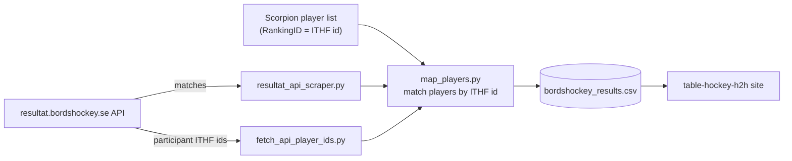

# Bordshockey.net Scraper



A GitHub Action runs this daily and commits the updated CSVs, which the [table-hockey-h2h site](https://github.com/amundfylling/table-hockey-h2h-cloudflare) reads.

This project scrapes table hockey tournament results from [bordshockey.net](https://bordshockey.net) and normalizes the data into a structured CSV format. It also includes a player mapping system to link scraped names to a canonical player database.

## Features

- **Automated Scraping:** Fetches tournament data including match results, stages, and dates.
- **Incremental Updates:** Checks existing result URLs to only scrape new tournaments when the CSV already has the current schema.
- **Source Links and IDs:** Writes stable tournament/stage IDs, source URLs, source match IDs when available, and explicit stage type.
- **Player Mapping:** Maps players to canonical Scorpion PlayerIDs, first by the ITHF id that the resultat.bordshockey.se API gives each tournament participant, then by exact matching, fuzzy matching (difflib), and manual overrides.
- **GitHub Actions:** Automated daily workflow to keep the dataset up-to-date.

## Files

- `bordshockey_scraper.py`: The main scraping script.
- `resultat_api_scraper.py`: Alternative fetcher that reads the JSON API behind resultat.bordshockey.se instead of parsing HTML. Same CSV schema.
- `compare_results.py`: Diffs two results CSVs, e.g. the HTML scraper's and the API fetcher's.
- `fetch_api_player_ids.py`: Fetches the ITHF and SBHF ids of every participant in the results' tournaments from the resultat API into `api_player_ids.csv` (only tournaments not cached yet).
- `map_players.py`: Matches every player entry (one name in one tournament) against `players_data.csv` and writes `player_entry_map.csv`, `player_id_map.csv`, `unmapped_players.csv` and the `Player1ID`/`Player2ID` columns of `bordshockey_results.csv`.
- `players_data.csv`: Scorpion player list (refreshed daily from Scorpion-Scraper-2.0). Its `RankingID` is the ITHF id.
- `api_player_ids.csv`: Cached API participant ids per tournament.
- `player_entry_map.csv`: The generated mapping of (SourceTournamentID, PlayerName) -> ITHF, SBHF, PlayerID and match method.
- `manual_mapping.json`: JSON file for manually correcting or ignoring player mappings.
- `bordshockey_results.csv`: The primary output dataset containing all match results.
- `player_id_map.csv`: The name-only mapping of ScrapedName -> PlayerID (fallback for entries without a usable ITHF id).
- `players.csv`: List of unique player names extracted from the results (generated by scraper).
- `unmapped_players.csv`: Names with at least one tournament entry that could not be confidently mapped.

## Usage

### Prerequisites

```bash
pip install -r requirements.txt
```

### Running the Scraper

To scrape new tournaments and append them to the results:

```bash
python3 bordshockey_scraper.py
```

If the existing CSV is missing required schema fields, the scraper refuses to append partial rows and rebuilds the archive instead. You can force a full rebuild explicitly:

```bash
python3 bordshockey_scraper.py --rebuild
```

To validate one or more specific tournament/result/stage URLs without touching the production CSV, write to a temporary file:

```bash
python3 bordshockey_scraper.py --csv /tmp/bordshockey_sample_results.csv --rebuild \
  --url "https://bordshockey.net/tavlingar/2526/swedish-masters/resultat/qualification-groups/grupp-1/?matcher=1" \
  --url "https://bordshockey.net/tavlingar/2526/swedish-masters/resultat/playoff-a/"
```

### Fetching from the resultat API

resultat.bordshockey.net (which redirects to resultat.bordshockey.se) is backed by a public JSON API ([docs](https://resultat.bordshockey.se/api-docs.html)) on the same database as bordshockey.net. `resultat_api_scraper.py` lists every finished tournament per season and reads its stages and matches from the API, writing the same CSV schema:

```bash
python3 resultat_api_scraper.py                       # append tournaments not yet in the CSV
python3 resultat_api_scraper.py --season 2627         # only one season
python3 resultat_api_scraper.py --csv /tmp/api.csv --rebuild --only 2526/swedish-masters
```

Compared with the HTML scraper on all 298 tournaments in `bordshockey_results.csv`, every existing row is reproduced with identical goals, overtime, StageID, StageSequence, StageType, Date, TournamentID, SourceStageID and SourceMatchID. Differences:

- The API has results for about 3,500 tournaments (local leagues and class variants such as `_junior`), not only the ones linked from the bordshockey.net archive page.
- It finds 277 matches the HTML scraper misses: single-group stages named "slutspel" that are round robins (e.g. `0910/oresund-cup` B-slutspel).
- Playoff games get a SourceMatchID.
- Stage and tournament names follow the new site, which renamed some of them: "B-Playoff" is now "B-slutspel", English stage names are Swedish, and "Svenska Mästerskapen" is "SM".

### Updating Player Mappings

To refresh the API ids and regenerate the mappings (e.g., after updating `manual_mapping.json`):

```bash
python3 fetch_api_player_ids.py
python3 map_players.py
```

## Output Schema

The CSV keeps the original Scorpion-compatible columns and appends:

```text
StageType, TournamentURL, ResultURL, StageURL, SourceURL, Source,
SourceTournamentID, SourceStageID, SourceMatchID
```

`StageType` is `round-robin` or `playoff`. `TournamentURL`, `ResultURL`, `StageURL`, and `SourceURL` link rows back to bordshockey.net. `TournamentID` and `StageID` are stable generated/source-backed IDs; raw bordshockey IDs are preserved in `SourceTournamentID`, `SourceStageID`, and `SourceMatchID` where available.

## Configuration

### Manual Mapping

Edit `manual_mapping.json` to handle specific cases:
- **Map to ID:** `"Scraped Name": 12345`
- **Ignore/No Match:** `"Scraped Name": null` (Prevents fuzzy matcher from guessing incorrectly)
- **Map an ITHF id:** `"ithf:280837": 12345` (wins over every other rule, for all tournaments where that ITHF id plays)

Name entries only apply to tournament entries without a usable ITHF id, and a name match is rejected when the Scorpion player it points to has a different `RankingID` than the entry's ITHF id.

### Players Scorpion does not have

`ITHF_ONLY_ID_OFFSET` in `map_players.py` gives players with an ITHF id but no Scorpion record `PlayerID = offset + ITHF id`. It is 1,000,000; set it to `None` to leave them unmapped.

## Automation

The `.github/workflows/scrape_daily.yaml` workflow runs `resultat_api_scraper.py` automatically every day at 18:00 UTC. Team tournaments are skipped. It commits any new data and mappings back to the repository.
