# Bordshockey.net Scraper



A GitHub Action runs this daily and commits the updated data files, which the [table-hockey-h2h site](https://github.com/amundfylling/table-hockey-h2h-cloudflare) reads. The diagram source is [`docs/flow.mmd`](docs/flow.mmd).

This project scrapes table hockey tournament results from [bordshockey.net](https://bordshockey.net) through the resultat API and normalizes the data into one results dataset. It also includes a player mapping system to link scraped names to a canonical player database.

## Features

- **Automated Scraping:** Fetches tournament data including match results, stages, and dates.
- **Incremental Updates:** Checks existing result URLs to only fetch new tournaments when the dataset already has the current schema.
- **Source Links and IDs:** Writes stable tournament/stage IDs, source URLs, source match IDs when available, and explicit stage type.
- **Player Mapping:** Maps players to canonical Scorpion PlayerIDs, first by the ITHF id that the resultat.bordshockey.se API gives each tournament participant, then by exact matching, fuzzy matching (difflib), and manual overrides.
- **GitHub Actions:** Automated daily workflow to keep the dataset up-to-date.

## Files

- `resultat_api_scraper.py`: Fetches results from the JSON API behind resultat.bordshockey.se.
- `fetch_api_player_ids.py`: Fetches the ITHF and SBHF ids of every participant in the results' tournaments from the resultat API into `api_player_ids.csv` (only tournaments not cached yet).
- `map_players.py`: Matches every player entry (one name in one tournament) against `players_data.csv` and writes `player_entry_map.csv`, `player_id_map.csv`, `unmapped_players.csv` and the `Player1ID`/`Player2ID` columns of the results dataset.
- `players_data.csv`: Scorpion player list (refreshed daily from Scorpion-Scraper-2.0). Its `RankingID` is the ITHF id.
- `api_player_ids.csv`: Cached API participant ids per tournament.
- `player_entry_map.csv`: The generated mapping of (SourceTournamentID, PlayerName) -> ITHF, SBHF, PlayerID and match method.
- `manual_mapping.json`: JSON file for manually correcting or ignoring player mappings.
- `data/bordshockey_results.parquet`: The primary output dataset containing all match results, updated daily. See [Data storage](#data-storage).
- `results_store.py`: Reads and writes the results dataset.
- `player_id_map.csv`: The name-only mapping of ScrapedName -> PlayerID (fallback for entries without a usable ITHF id).
- `unmapped_players.csv`: Names with at least one tournament entry that could not be confidently mapped.

## Usage

### Prerequisites

```bash
pip install -r requirements.txt
```

### Fetching from the resultat API

resultat.bordshockey.net (which redirects to resultat.bordshockey.se) is backed by a public JSON API ([docs](https://resultat.bordshockey.se/api-docs.html)) on the same database as bordshockey.net. `resultat_api_scraper.py` lists every finished tournament per season and reads its stages and matches from the API, writing the results dataset:

```bash
python3 resultat_api_scraper.py                       # append tournaments not yet in the dataset
python3 resultat_api_scraper.py --season 2627         # only one season
python3 resultat_api_scraper.py --csv /tmp/api.csv --rebuild --only 2526/swedish-masters
```

Before the switch from the old HTML scraper, the API output was checked against its 298 tournaments: every row was reproduced with identical goals and ids. The API also covers about 3,500 tournaments (local leagues and class variants), gives playoff games a SourceMatchID, and uses the new site's stage and tournament names.

### Updating Player Mappings

To refresh the API ids and regenerate the mappings (e.g., after updating `manual_mapping.json`):

```bash
python3 fetch_api_player_ids.py
python3 map_players.py
```

## Data storage

With every tournament the API has, the results are about 316k rows. As CSV that is 143 MB, over GitHub's 100 MB file limit, so the dataset is stored as Parquet (zstd), which is about 3 MB. Column names are the same as the old CSV's. The id and count columns are nullable integers, and `SourceTournamentID`, `SourceStageID` and `SourceMatchID` are strings.

```python
import pandas as pd

url = "https://raw.githubusercontent.com/amundfylling/bordshockey.net-scraper/main/data/bordshockey_results.parquet"
results = pd.read_parquet(url)  # needs pyarrow
```

All scripts default to the Parquet file. Pass a `.csv` path to `--csv`/`--results` to work on a CSV instead.

## Output Schema

The dataset keeps the original Scorpion-compatible columns and appends:

```text
StageType, TournamentURL, ResultURL, StageURL, SourceURL, Source,
SourceTournamentID, SourceStageID, SourceMatchID
```

`StageType` is `round-robin` or `playoff`. `TournamentURL`, `ResultURL`, `StageURL`, and `SourceURL` link rows back to bordshockey.net. `TournamentID` and `StageID` are stable generated/source-backed IDs; raw bordshockey IDs are preserved in `SourceTournamentID`, `SourceStageID`, and `SourceMatchID` where available.

## Configuration

### Manual Mapping

Edit `manual_mapping.json` to handle specific cases:
- **Map to ID:** `"Scraped Name": 12345`
- **Ignore/No Match:** `"Scraped Name": null` (Prevents fuzzy matcher from guessing incorrectly)
- **Map an ITHF id:** `"ithf:280837": 12345` (wins over every other rule, for all tournaments where that ITHF id plays)

Name entries only apply to tournament entries without a usable ITHF id, and a name match is rejected when the Scorpion player it points to has a different `RankingID` than the entry's ITHF id.

### Players Scorpion does not have

`ITHF_ONLY_ID_OFFSET` in `map_players.py` gives players with an ITHF id but no Scorpion record `PlayerID = offset + ITHF id`. It is 1,000,000; set it to `None` to leave them unmapped.

## Automation

The `.github/workflows/scrape_daily.yaml` workflow runs `resultat_api_scraper.py` automatically every day at 18:00 UTC. Team tournaments are skipped. It commits any new data and mappings back to the repository.
